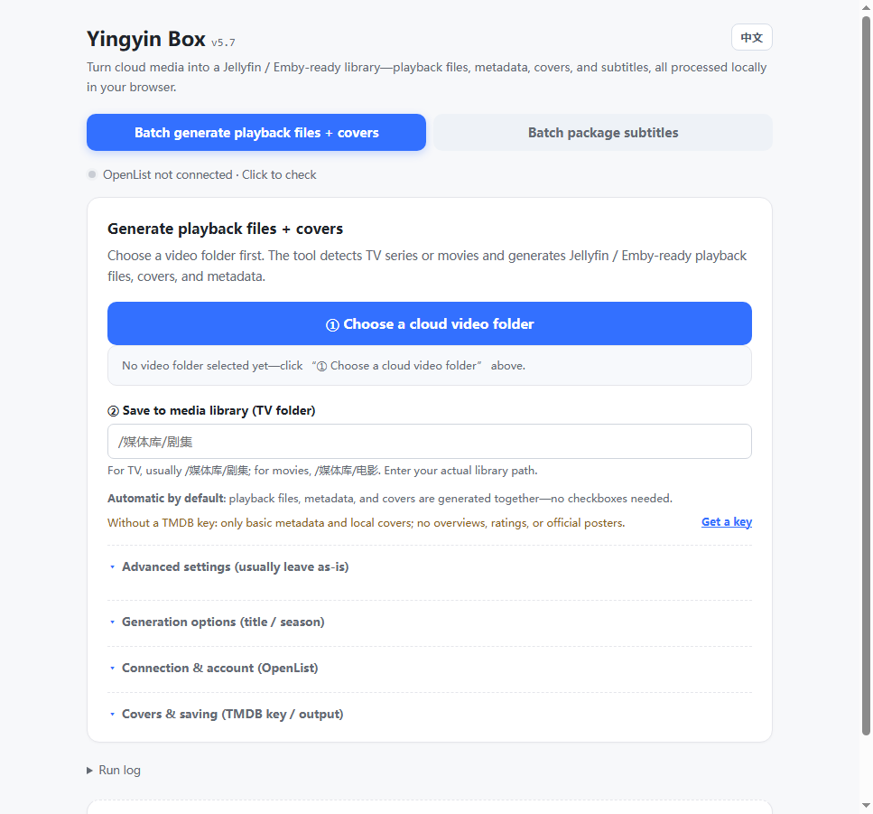
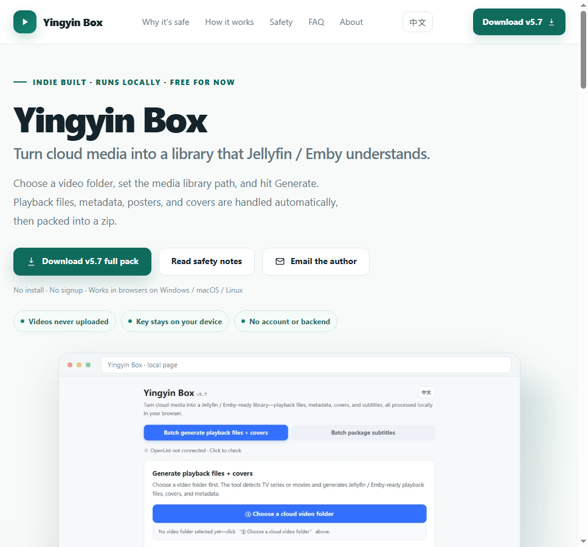

# Yingyin Box

**A local-first, single-file media-library ingester for OpenList → Jellyfin / Emby.**

Yingyin Box turns a cloud-drive folder into a clean, player-ready media library: `.strm` play files, Jellyfin/Emby-compatible NFO metadata, posters, season artwork, and renamed subtitles. It runs as one HTML file in your browser — no installer, no hosted account, and no author-side copy of your videos. v6.0 adds a `manifest.json` inside every zip so the next week's re-run can diff and generate only what changed.

[中文说明](README.zh-CN.md) · [Website](https://yingyin-box-site.pages.dev/) · [Releases](../../releases)


## What it does

- **Scan a source folder** through OpenList, or pick a local folder in a Chromium-based browser.
- **Generate `.strm` files** with the correct episode structure for Jellyfin and Emby.
- **Write NFO metadata** for shows, seasons, episodes and movies.
- **Fetch optional TMDB metadata** — overview, rating, cast, official posters and backdrops. A TMDB key is not required.
- **Create a local fallback cover** when no poster is available, so the library never shows a blank tile.
- **Rename subtitles** to match the video, or keep the original file name.
- **Package or upload** the result: download a zip, or write directly into your media-library folder.
- **Re-run without rebuilding the whole library:** every zip contains `manifest.json`; import it next time to generate only new or changed entries.
- **Never overwrite by default:** local `poster.jpg`, hand-edited NFO and existing artwork are skipped unless you explicitly enable overwrite.
- **Carry state with the library:** the manifest travels with the unzipped folder, so clearing browser storage or changing computers does not lose the diff baseline.
- **Switch the UI** between English and Chinese from the top-right corner. Chinese remains the default.



## Why local-first

| Data | Where it goes |
| --- | --- |
| Video files | Stay on your computer or NAS. The app reads folder names and file names only; it never uploads the video. |
| OpenList credentials | Used in page memory for the current session; not written to the config file. |
| TMDB API key / token | Stored in this browser's `localStorage`; config export strips it. |
| Media library output | Written to the folder you choose, or delivered as a zip. |
| Analytics / ads | None. The app page loads no third-party scripts and has no telemetry. |

The app itself has **no business backend that receives videos, keys or OpenList credentials**. The project website has one small server endpoint for its contact form; it receives only a name and message, never media files, OpenList passwords or TMDB keys.

## Quick start

1. **Open** the online app at [yingyin-box-site.pages.dev/app.html](https://yingyin-box-site.pages.dev/app.html), or download the full pack from [Releases](../../releases) if you want an offline copy.
2. **Run** it in Chrome or Edge. There is no install step.
3. **Choose a source**: enter your OpenList URL and credentials, or use the local folder picker.
4. **Set the media-library path**, for example `/media/tv` or `/media/movies`. This is the destination path inside the generated zip, not an upload address.
5. **Optional:** import the `manifest.json` from your previous zip to diff against the last run.
6. **Optional:** add a TMDB v3 API key or v4 access token for richer metadata and official artwork.
7. **Generate** and unzip the result into your Jellyfin/Emby library. The zip contains `manifest.json` at its root.

If your browser cannot write directly to a local folder, the app falls back to a zip download. The generated folder structure still works the same way.

## Reproducible build

Source lives in `src/` (`shell.html`, `app.js`, `i18n.js`). The shipped single-file HTML is produced by `tools/build.mjs`:

```bash
# macOS / Linux
BUILD_COMMIT=$(git rev-parse --short=12 HEAD) node tools/build.mjs .
# Windows PowerShell
$env:BUILD_COMMIT=(git rev-parse --short=12 HEAD); node tools\build.mjs .
```

The build injects the commit into the page footer and into `manifest.json`, then minifies with Terser and writes `downloads/yingyin-box-v6.0.html` and an identical online copy at `app.html`. Run `build.ps1` or `build.sh` for the same result. The page prints `本版构建自 <commit>` and links to that commit; the same value is written into every generated `manifest.json`.

## Downloads

| Package | Size | SHA-256 |
| --- | --- | --- |
| Web app (`yingyin-box-v6.0.html`) | 196,090 bytes (191 KB) | `c51c7514c4a0b07f6063e23dc69badcc2952508627655288ee73e7d4bb058611` |
| Online app (`app.html`) | identical bytes | `c51c7514c4a0b07f6063e23dc69badcc2952508627655288ee73e7d4bb058611` |
| Full pack (`yingyin-box-v6.0.zip`) | 77,528 bytes (76 KB) | `25a26e4744288f1c1c9fc85b04f8646567e9682a54adca4c6844714b65d8878d` |

The full pack contains the web app, a usage guide, four NFO examples, and `放这儿看我.txt`. Every generated zip also contains `manifest.json` and the same quick-start note.

## Bilingual UI

The website and the app both have an `EN / 中文` switch in the top-right corner.

- The website switches its full page: hero, navigation, download section, security notes, FAQ, contact dialog and hero screenshot.
- The app switches labels, buttons, select options, dialogs, hints and common runtime messages.
- The choice is stored in `localStorage` under `yingyin_ui_lang`; Chinese is the default.
- The app's existing **metadata language** selector is separate: it controls the language of generated NFO metadata, not the UI.



## Requirements

- **Browser:** Chrome or Edge on desktop is recommended. Safari/Firefox can still generate a zip when direct folder writing is unavailable.
- **Source:** an OpenList instance, or a local folder.
- **Library:** Jellyfin or Emby, if you want to consume the generated `.strm` + NFO structure.
- **Metadata (optional):** a TMDB API key or access token.

## Security notes

This is a single-file tool that you can read before running. A few practical precautions:

- Download only from this repository, the official website, or the release attachments.
- Some browsers show a conservative warning for downloaded HTML files. That warning is not a virus verdict; inspect the source, scan the file, or try it in a separate browser profile.
- Do not enter API keys on a shared computer. Keys are stored in that browser profile's `localStorage`; use **Clear TMDB key** when finished.
- Use HTTPS for your OpenList endpoint when it is exposed outside your LAN.
- Treat the generated media-library path as a write permission: point it at a test folder first.

## Verify a download

`SHA256SUMS`, `SHA256SUMS.sig`, `allowed_signers` and `signing-key.pub` ship with every release. Full commands are in [`docs/VERIFY.md`](docs/VERIFY.md). Short version:

```bash
sha256sum -c SHA256SUMS
ssh-keygen -Y verify -f allowed_signers -I a-splash-of-water -n yingyin-box-SHA256SUMS -s SHA256SUMS.sig < SHA256SUMS
```

The page footer prints the commit it was built from; the same commit is written into every generated `manifest.json`. A downloaded HTML keeps working offline and never calls back.

## FAQ

**Does it upload my videos?** No. It reads directory and file names and generates play files/metadata. The video bytes stay on your storage.

**Can I use it without a TMDB key?** Yes. You get basic NFO metadata and a local title cover. A key adds overviews, ratings, cast and official artwork.

**Does it save my NAS password?** The OpenList password is used in page memory for the current session and is not written to the config file.

**Is this affiliated with TMDB, Jellyfin, Emby or OpenList?** No. These names are used only to describe compatibility. This is an independent personal project.

**Why does my browser warn about the HTML file?** Single-file HTML downloads often trigger a generic warning. Review the source and scan the file; the project has no installer and no bundled binaries.

## Contributing

Issues and pull requests are welcome in English or Chinese.

- Keep the app a **single, reviewable HTML file** unless there is a strong reason to split it.
- Do not add analytics, ads, tracking pixels or hidden network calls.
- Never commit API keys, tokens, passwords, `.env` files or Cloudflare secrets.
- Test both Chinese and English UI, and check that existing generation behavior is unchanged.
- For security reports, use GitHub's private security advisory rather than a public issue.

## License

MIT — see [LICENSE](LICENSE).

---

**Keywords:** OpenList, Jellyfin, Emby, media library, `.strm`, NFO, metadata, posters, subtitles, self-hosted, local-first, single-file web app, bilingual UI.
